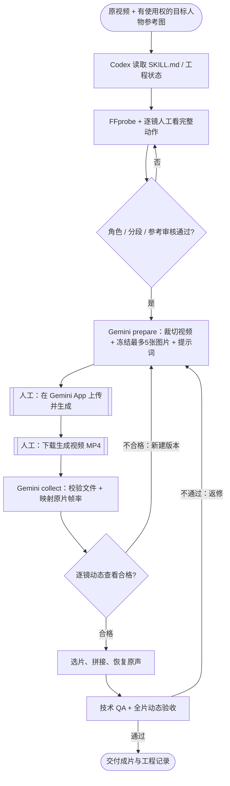

# AI 视频人物替换 Skill｜Gemini App 无 API Key 版

**用 Codex 管理原片、分镜、角色参考与后期，使用 Gemini App 生成新视频。** 不需要购买 DGX Spark、不需要部署 MiniMax H3，也不需要 Gemini API Key；但 **Gemini App 必须由用户手动上传素材、生成并下载 MP4**。不是“只运行一条命令就自动生成整条 MV”。

> 本 Fork 新增 Gemini App 人工交接路径，**没有把 MiniMax H3 的 ComfyUI 节点直接改成 Gemini API**。旧版 H3 / DGX Spark 仍完整保留：[原版 README](README_H3.md) · [原版作者](https://github.com/JayceHuang/recast-video-dgx)。新功能需要在本地测试，暂不声称已通过 Gemini App 实机端到端验收。

[](https://github.com/AsleepForNow/recast-video-dgx)

## 项目做什么？

原版 `recast-video-dgx` 是一套 **Codex Skill**，指导 AI 代理先分析视频、逐镜确认人物和动作，再准备替换角色参考、生成视频、复用原声、拼接与验收。Fork 把 **Gemini App 手动生视频** 作为默认路线，保留大部分原有本地工具。

| 工作环节 | 谁来完成 | 产物 |
| --- | --- | --- |
| 读取已有工程、分析原视频与停止状态 | Codex + Python/FFprobe + 人工看完整动作 | 工程、源片指纹、分镜表 |
| 核实人物、动作、服装、参考图 | Codex 辅助 + 用户人工确认 | 逐镜参考与审核记录 |
| 导出待编辑镜头与提示词 | `scripts/gemini_app.py prepare` | MP4、最多 5 张参考图片、`prompt.txt`、`handoff.json` |
| **真正的视频生成** | **你在 Gemini App 手动上传、生成、下载** | 原始 Gemini 生成 MP4 |
| 对齐回原片帧率/帧数 | `scripts/gemini_app.py collect` | 已映射的片段、追溯信息 |
| 选片、拼接、复用原声 | `scripts/recast.py assemble` / FFmpeg | 内部待审影片 |
| 检查与返修 | `scripts/recast.py qa` + **人工连续播放** | 技术报告、验收记录、新版任务 |

### 工作流程图



更多解释请看 [Gemini 手动工作流完整说明](references/gemini-app.md)。

## 先核对 Gemini App 能否使用

Google 官方对 Gemini App 的视频生成/编辑功能有账号和地区限制：

- **个人 Google 账号需有符合条件的 Google AI 方案**。只有免费 Gemini App，并不等于有视频生成额度；视频创作入口是否可用，要以你的 App 实际显示为准。
- Gemini Omni 视频创作页面可上传**一段源视频 + 最多五张图片**，支持视频编辑及多轮调整，但不承诺逐帧锁定动作。
- 在部分国家、地区或美国部分州，上传已有视频进行视频编辑不可用。
- 本 Fork 为降低不确定性，**每个导出分镜最多 10 秒**。如果视频更长，先按完整动作合理拆镜，不能硬切断关键动作。
- 建议先用**自己拥有版权和人物授权的短视频**做概念验证；不要直接用历史《流星雨》案例的未授权媒体素材测试或商用。

> 来源：[Google Gemini iPhone/iPad 视频功能官方说明](https://support.google.com/gemini/answer/16126339?co=GENIE.Platform%3DiOS&hl=en)。你在本项目使用的是 **Gemini App**，不是 Gemini API；Google 开发者的 `gemini-omni-1.1-flash` API 功能不能自动等价为你的 App 权限。

## 1. 安装 Codex Skill

依赖：**Python 3.10+**、`ffmpeg`、`ffprobe`。在本地电脑用终端执行：

```bash
mkdir -p ~/.codex/skills
git clone https://github.com/AsleepForNow/recast-video-dgx.git ~/.codex/skills/recast-video-dgx
```

如果目标目录已经存在，先备份或更新现有仓库，不要直接覆盖。**安装 Skill 不会启动生成，更不会恢复任何以前停止的项目。**

随后对 Codex 说：

> 使用 $recast-video-dgx，选择 **Gemini App 无 API Key 人工交接模式**。先检查原片、人物和参考图，合理分镜并列出审核问题；生成每个镜头的 Gemini App 输入包和提示词。不要连接 DGX，不要调用 MiniMax H3，不要自动访问 Gemini 账户，更不要声称已经生成视频。我下载 Gemini 结果后再交给你拼接与检查。

## 2. 准备原片和分镜

先看视频源文件的时长、帧数、音轨；建新工程，保留独立副本：

```bash
cd ~/.codex/skills/recast-video-dgx
python3 scripts/recast.py probe /path/to/source.mp4
python3 scripts/recast.py init /path/to/my-project --source /path/to/source.mp4 --id my-film
```

在工程的 `01_分镜与动作/plan.json` 填好从 0 开始的 `[start,end)` 源帧区间：覆盖全部帧、不能重叠。先实际查看完整动作，再决定切点；`validate-plan` 可检查：

```bash
python3 scripts/recast.py validate-plan /path/to/my-project/01_分镜与动作/plan.json --require-review
```

该命令要求每段已经有真实的动作审核通过记录。**审核并不是由脚本自动替你完成的。**


## 3. 每个镜头生成一个 Gemini 上传包

复制 [Gemini 任务示例](examples/gemini-task.example.json)，修改它的 `source`、`start`、`end`、人物名称、参考图路径、真实动作描述和两个实际审核记录：

```bash
cp examples/gemini-task.example.json /path/to/S001-v001.json
# 编辑该 JSON，填写自己的文件路径；审核者本人在实际审查后填写 passed / reviewer / at / evidence

python3 scripts/gemini_app.py prepare /path/to/S001-v001.json /path/to/handoff/S001-v001
```

输出结构如下：

```text
handoff/S001-v001/
├── handoff.json                # 分镜、源片SHA、输入文件指纹
├── prompt.txt                  # 复制进 Gemini 的文字提示
└── inputs/
    ├── segment_for_gemini.mp4  # 裁切后要上传的原片镜头
    └── reference_1.png         # 1~5 张目标角色/场景参考图
```

**注意：** 后缀遵循你实际参考文件，可能是 PNG/JPG/WEBP。准备好后该目录视为不可变的单次任务版本；修改参考或提示词要创建 `v002`，不要直接覆盖 `v001`。


## 4. 手动在 Gemini App 生成视频（关键人工步骤）

在手机 Gemini App 或 [Gemini 网页版](https://gemini.google.com/) 中：

1. 打开 **Videos / 创建视频** 功能；没有入口先确认 Google AI 订阅与地区，不尝试绕过权限。
2. 上传 `inputs/segment_for_gemini.mp4` 和任务里的参考图片（最多 5 张）。
3. 将 `prompt.txt` 的文本粘贴到提示框；明确哪些人被替换，保留哪些镜头、动作和服装。
4. 生成后实际观看；如需修改，可在 App 支持时继续多轮编辑。
5. 将结果下载为 MP4，传回运行 Codex 的电脑。

> **人工边界**：Codex 不会在本路线里替你登录 Gemini、点击视频生成或自动下载；也不会调用任何 Gemini API。Gemini 输出的实际时长、动作和人物一致性需要检查。

## 5. 导回 Codex，恢复时间线

```bash
python3 scripts/gemini_app.py collect \
  /path/to/handoff/S001-v001 \
  /path/to/gemini-downloaded.mp4 \
  /path/to/mapped/S001-v001.mp4
```

`collect` 会验证输入包没有被修改、探测生成视频真实 FPS 并映射到原片这段应有的帧数。**如果 Gemini 视频长度不足，会拒绝静默补最后一帧**。它不会修复 AI 生成造成的脸部、动作或场景偏差，也不会自动标记视觉验收通过。

对于多镜头视频，按顺序完成所有段；通过逐镜动态审核后，更新工程 `plan.json` 里各段的 `selected_file` 路径及真实审核记录。随后使用现有合成与技术质检：

```bash
python3 scripts/recast.py assemble \
  /path/to/my-project/01_分镜与动作/plan.json \
  /path/to/source.mp4 \
  /path/to/internal-preview.mp4 --preview

# 下面的 120 和 30000/1001 只是示例；必须换成完整原片的真实帧数和 FPS
python3 scripts/recast.py qa \
  /path/to/internal-preview.mp4 \
  /path/to/qa.json \
  --frames 120 --fps 30000/1001 --audio-source /path/to/source.mp4
```

`assemble --preview` 只生成内部待审片；正式交付必须逐段有技术审核、完整动态视觉验收及对应文件指纹，并实际看完整片检查同步。源音轨从原片复用，不能因为输出有声音就当作保留了原声。

## 关键文件与两条路线

| 文件 | 用途 |
| --- | --- |
| [SKILL.md](SKILL.md) | Codex 入口；选择 Gemini 人工模式或 H3 原生模式 |
| [scripts/gemini_app.py](scripts/gemini_app.py) | Gemini App 本地准备、哈希校验与结果映射，不联网 |
| [references/gemini-app.md](references/gemini-app.md) | 人工交接说明、完整流程图、限制与示例 |
| [examples/gemini-task.example.json](examples/gemini-task.example.json) | Gemini 分镜任务输入模板 |
| [scripts/recast.py](scripts/recast.py) | 原片探测、工程初始化、源帧计划、合成、技术 QA 等 |
| [README_H3.md](README_H3.md) | **原版完整 H3 / DGX Spark 说明**，仍可照旧使用 |
| [references/comfyui.md](references/comfyui.md) | 只有选 H3 模式才需要的 ComfyUI 拓扑 |
| [VALIDATION.md](VALIDATION.md) | 原打包的测试范围；不代表 Gemini 新模式已实机通过 |

## 已知限制与版权

这是一个**Gemini App 半自动替换工作流**，不是 Gemini 的“无 Key 自动化 API”，也不保证每段精确替换目标人物。生成可能出现身份漂移、动作变化、手势错误、嘴形不齐、时长不同或无法生成。项目不得伪造审核结果、运行记录、模型参数或把历史 H3 案例当成 Gemini 实测。

- 每一镜建议独立保存原片、参考、Prompt、下载的生成片、选择结果和质检记录，失败就建新版本。
- 历史 [F4《流星雨》案例](examples/f4-case-study.md) 与 [24 组配图](examples/gallery.md) 仍是 **H3 历史教学资料**；并非 Gemini 生成实例。
- [媒体和肖像许可提示](MEDIA_NOTICE.md)：原 MV、音乐、人物肖像、媒体素材等许可不自动从代码 MIT License 获得。
- [LICENSE](LICENSE) 保留原代码许可证与上游版权信息；第三方 `vendor/` 目录继续遵循各自许可证。

原作者与素材包入口：[JayceHuang/recast-video-dgx](https://github.com/JayceHuang/recast-video-dgx) · [原作者夸克资料包](https://pan.quark.cn/s/aff1c565d543)。本 Fork 新增的是 **Gemini App 人工交接改造**，不是原作原创权的重新声明。

