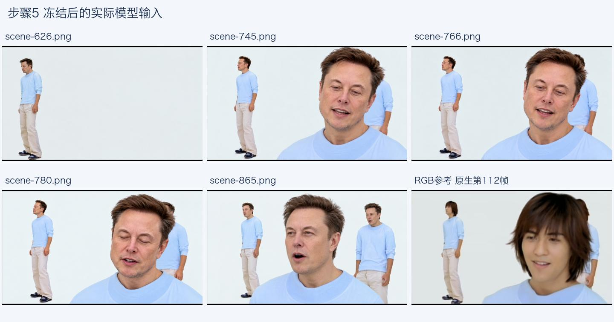
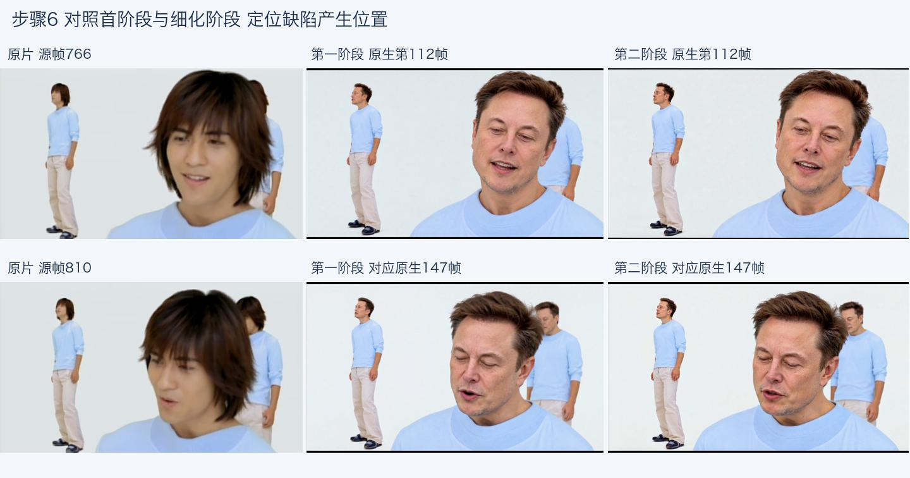
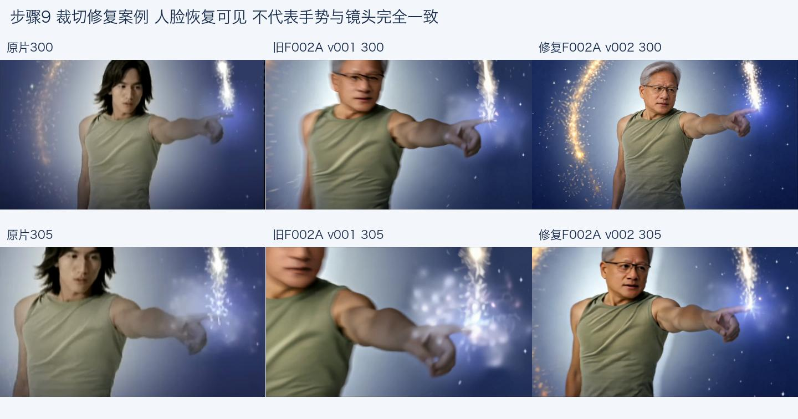
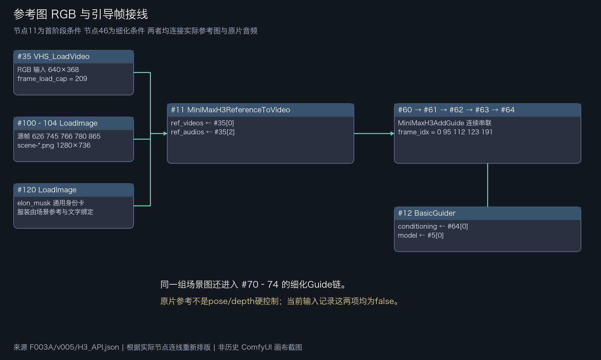
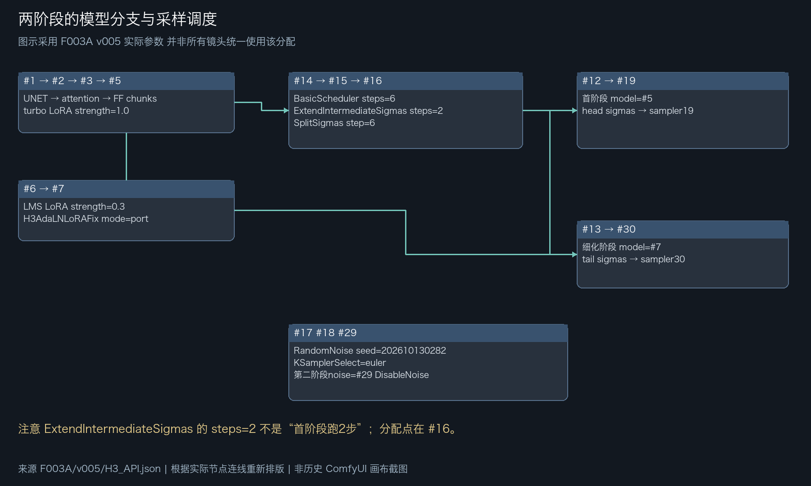
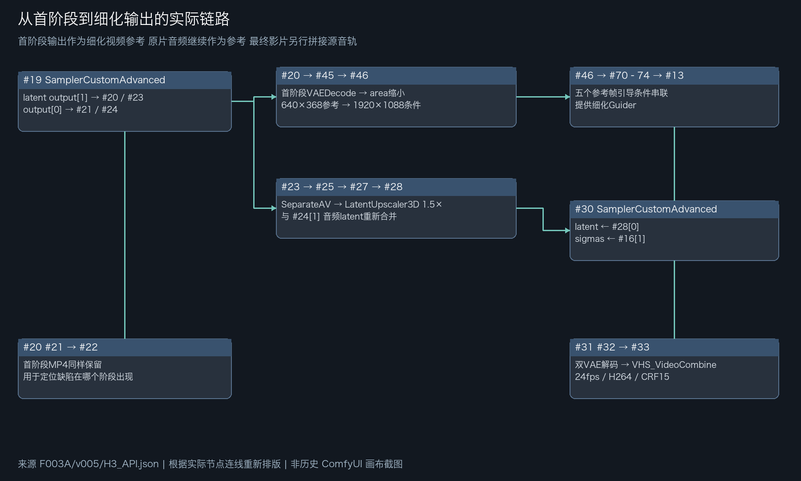

# F4《流星雨》：从原片到完整内部审看片

这是历史实例，不是可执行队列；用户已要求停止渲染。封装此Skill没有重启生产、消费者或监督。

## 源片与角色

源MV为852×480，8163帧，30000/1001fps，视频约272.3721秒；完整原声独立保留。不要与早期约30秒工程混淆。

| 原演员 | 目标人物 | 轨迹标识 |
|---|---|---|
| 言承旭 | 黄仁勋 / Jensen Huang | R4 |
| 周渝民 | Elon Musk | R2 |
| 朱孝天 | Sam Altman | R3 |
| 吴建豪 | Dario Amodei | R1 |

旧素材曾有Sam/Musk映射相反的问题；不能直接复用。逐镜需要用服装和人物位置核实，而不能只看文件夹名。

## 完整流程的实际关卡

1. 读取完整源片，41个自动候选切点需要核查拼贴、漏切与完整动作，最终v004选片表包含54段；候选数与执行段数不是同一概念。
2. 给四个身份准备身份卡，逐镜补scene参考，检查服装、姿势、遮挡、构图。更多scene图用图像工具生成与人工看图，不宣称RGB硬锁动作。
3. 将审核后的图缩放补边为模型实际输入，保存RGB24fps参考、输入SHA、API图及native-spec。源时钟不变；padding满足原生帧长要求。
4. 首批在三台独立world1生成不同片段。更早的双Spark仓库则是world2两台合算同一段，本Skill保留两条路线，不混称。
5. 保留首阶段与第二阶段MP4、history/events/exit、回收记录。按真实源起点映射回30000/1001，不把重连当重新提交。
6. 用实际选片合成完整v004内部待审，完整技术检查与原声检查和视觉验收分别记录。
7. 对问题局部返修：F002A裁头/推近，F039深弯腰/构图，F003A眼神/嘴形；新版存在不意味着进入完整版。
8. 依用户停止要求结束生成；之后使用已有记录整理审看片、横屏片头/黄小木水印和图文教程。包装版本不替代视觉验收。

## F003A怎样看输入与输出

源范围 `[626,866)`，240源帧；原生24fps生成209帧，scene源帧626/745/766/780/865对应Guide0/95/112/123/191。这里native_source_start为626，不是0。实际任务还含Musk身份卡与RGB视频。

图里五张scene已做模型尺寸补边，最后一格是RGB参考。它们与02目录的准备图分别留档。

v005补了766半睁眼参考，758/766局部改善，但774/810仍有眼神相位差、嘴形也未一致。这份结果不能标视觉通过，也没有据此替换v004当前选片。

F002A对照中左为源片、中为旧v001、右为修复v002。裁头改善仍须看身体尺度、手轨迹与推近时刻，不能只选更好看的一格。

## 实际ComfyUI图

这三张及README总览是根据真实API JSON重绘，非历史ComfyUI画布截图。没有借示意图声称当时界面已截图。原图SHA及提取范围写在PROVENANCE.json。

## 文档与归档

[飞书图文教程](https://my.feishu.cn/wiki/MpXMwTxLDi6OURkerkhcclgUn2P)已含24组图（访问取决于读者权限）；Skill内的[本地画廊](gallery.md)可离线查看。每组图附来源和检查重点。完整MV、人物原始身份卡、全部生成片与权重未随Skill分发。

F4是已经有技术产物但仍保留视觉问题的教学案例，不能宣称整片所有目标均验收通过。后续项目应继承可复用规则，不继承这些旧run、旧PID、绝对机器路径或已停止监督。
