# 24组示例配图

图片来自本工程已有图文素材；失败与局部改善例仍保留原审核范围。原片截图不代表生成结果，API图不代表历史界面截图。

## 图1 全流程说明图；非软件截图

## 图2 源片分镜概览

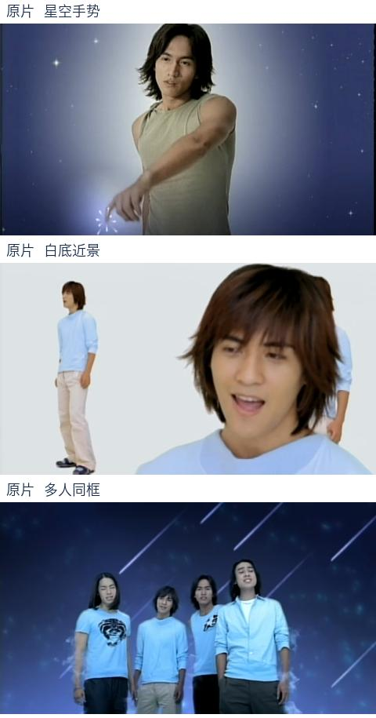

## 图3 实际角色场景参考

## 图4 构图/弯腰问题对照

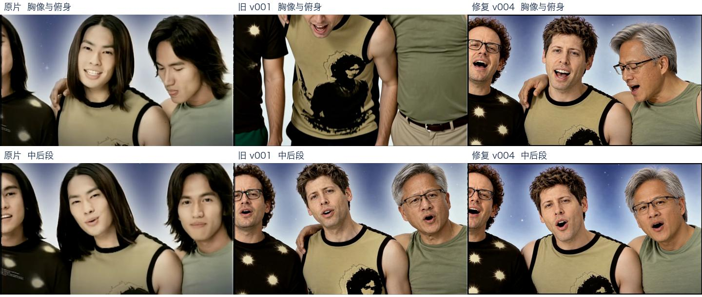

## 图5 眼神问题对照

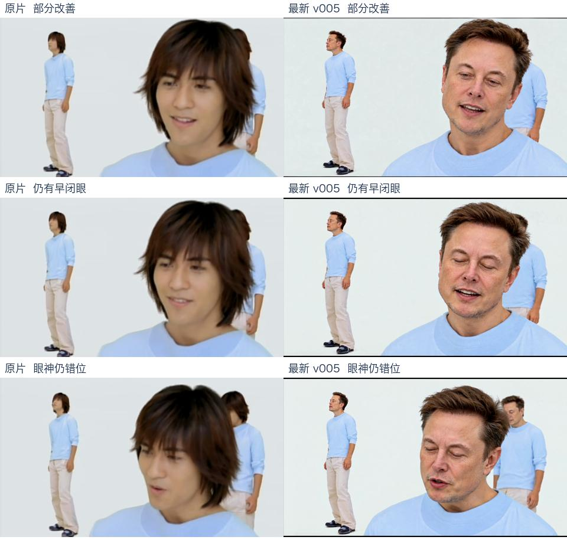

## 图6 嘴形问题对照

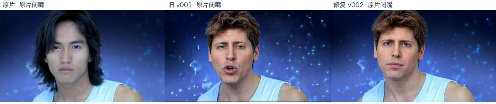

## 图7 接段问题对照

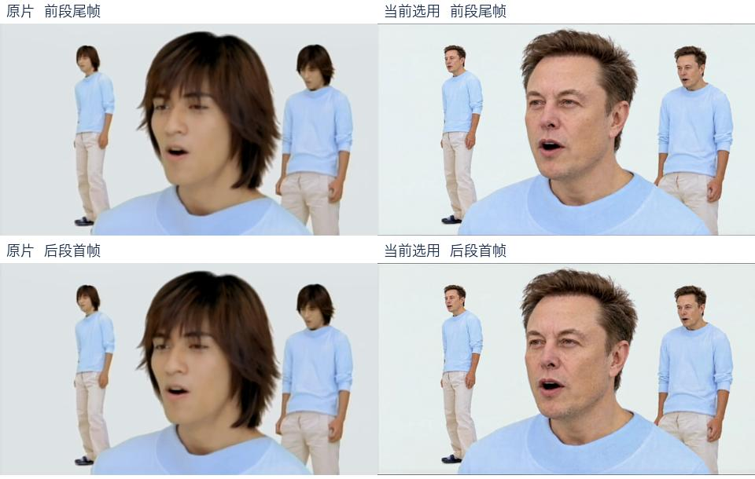

## 图8 多人身份画面

## 图9 真实API重绘总览；非历史界面截图

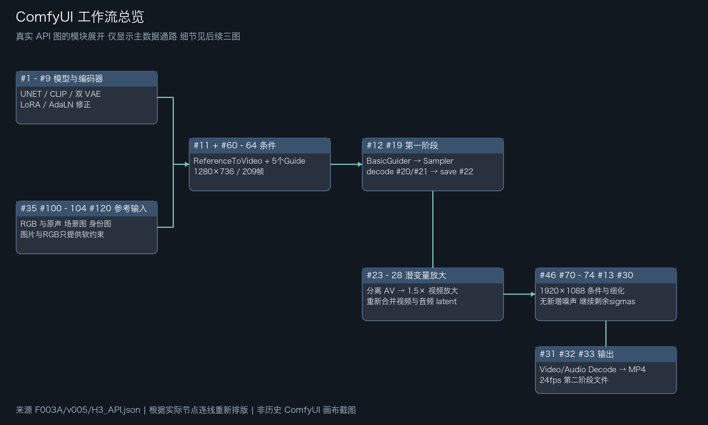

## 图10 真实API重绘参考输入/Guide；非历史界面截图

## 图11 真实API重绘模型与采样；非历史界面截图

## 图12 真实API重绘放大与输出；非历史界面截图

## 图13 步骤1配图 识别原片中的不同任务

左上是多人同框，星空段有手势与特效，白底近景要检查嘴形和眼神，蓝衣多人段要检查遮挡。先看这几类镜头，再决定哪里需要更多参考图与更密的质检。

来源：00_原片/官方完整版MV；源帧92、185、758、4261、4955、7551。

## 图14 步骤2配图 区分身份卡和场景服装

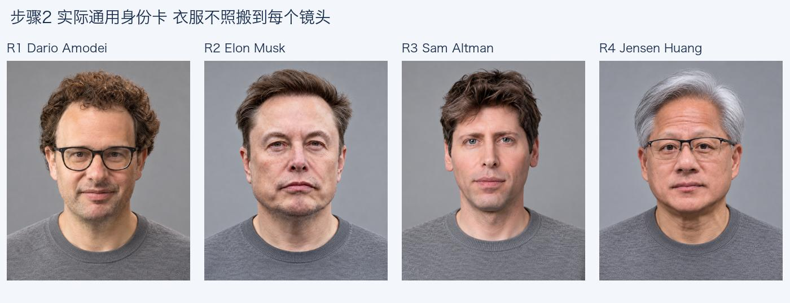

这四张是实际使用的通用身份卡。R1=Dario，R2=Musk，R3=Sam，R4=Jensen。身份卡主要告诉模型“换成谁”；场景参考与提示词再约束“穿什么、站哪里、做什么”。不要把身份卡的衣服直接带进每个镜头。

来源：工程外 影片资产库/角色卡/<身份>/通用身份_v001/身份照_正面.png。

## 图15 步骤3配图 看懂分段与共享边界

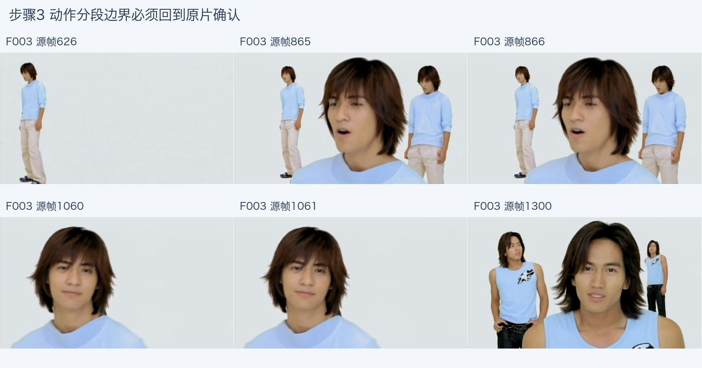

865是A段最后一帧，866是B段第一帧；1060和1061是下一组边界。它们都是生成任务的边界，不一定是原片硬切。下一段可使用实际前段尾帧作为参考，但剪辑时共享画面只出现一次。

来源：源片F003；各区间以01_分镜与动作/首批执行计划.json为准。

## 图16 步骤4配图 原片到目标参考的对应关系

上排原片，下排是本工程真实生成并审核过的场景参考。每一列保留相近的背景、人物位置、服装和遮挡，同时替换身份。766帧专门补了半睁眼条件，但参考图与原片仍有头角和嘴形幅度差异；这类误差要在生成前记下来。

来源：02_场景参考/F003A/target-first、v005/target-766、target-last。

## 图17 步骤5配图 真正送入模型的素材

scene文件已经按模型尺寸缩放补边，和02目录中的准备素材有区别。最后一格是24fps RGB参考视频帧，不是生成结果。输入记录保存这些文件的SHA256，因此更改参考以后应新建版本，不能覆盖已提交包。

来源：03_提示词与任务/F003A/v005；RGB与场景输入为实际文件。

## 图18 步骤6配图 一阶段和二阶段到底有什么区别

每行按源片、首阶段、第二阶段排列。两阶段输出都保留，可以定位错误是首阶段已发生，还是细化后加重。766和810的眼神变化仍与原片不同，说明第二阶段更细致并不自动等于动作更准确。两种原生画面带少量模型补边，这里仅缩放展示。

来源：04_生成片段/f4full-f003a-v005-20261016；原生24fps样本112、147。

## 图19 步骤7配图 帧率恢复不是把动作加速

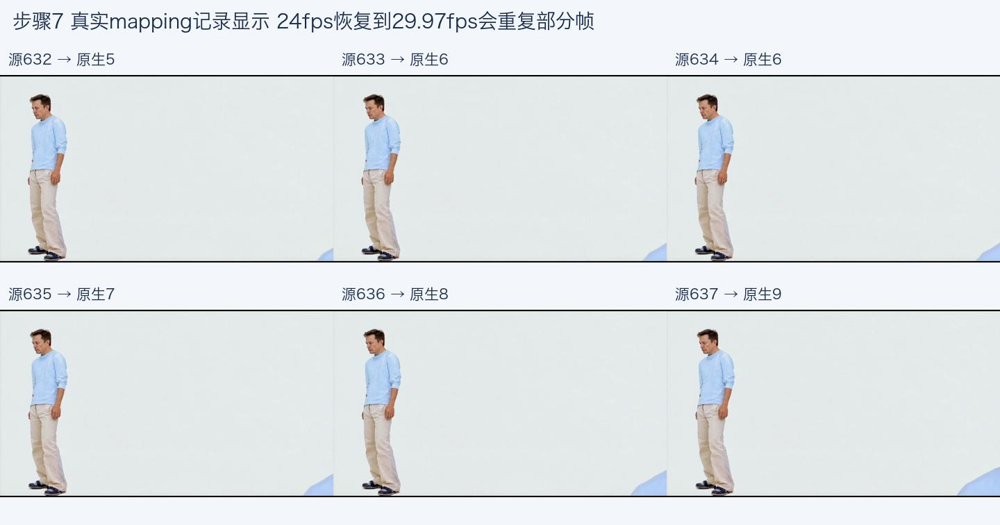

相邻成片帧可能指向同一原生帧，图上已经写出实际索引。240帧成片来自24fps原生序列的时间映射，恢复的是源时钟，不是光流插帧，也不保证嘴形精准。每帧具体对应关系可以查mapping.json。

来源：05_后处理/首批_v005/F003A/mapping.json与mapped.mp4。

## 图20 步骤8配图 接段检查不能只看一张尾帧

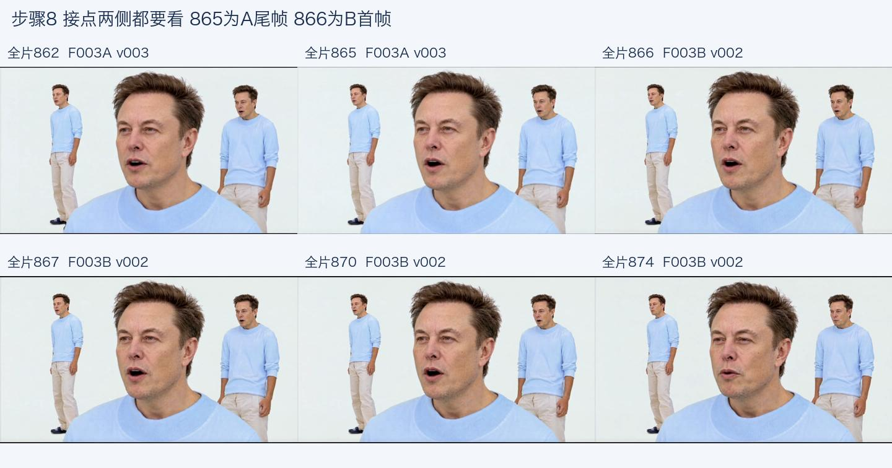

六个样本跨过A/B边界，检查头部位置、背景人物、衣服和嘴形是否突然跳变。这些图只适合做静态初筛，接点仍要连续播放；截图无黑帧不代表整片没有黑帧或动作重复。

来源：完整版v004；A选v003，B选v002；全片帧862、865、866、867、870、874。

## 图21 步骤9配图 修复是否有效要和旧版放一起看

每行左为原片，中为旧v001，右为修复v002。300和305附近原来的过早裁头有改善，但身体尺度、手指轨迹与推近时刻仍可能不同。修复记录应写“哪一项改善、哪一项还没过”，避免只换上更漂亮的一帧。

来源：F002A同源帧300、305；05_后处理/首批_v001与首批_v002。

## 图22 步骤10配图 拼成全片后还要跨镜头复查

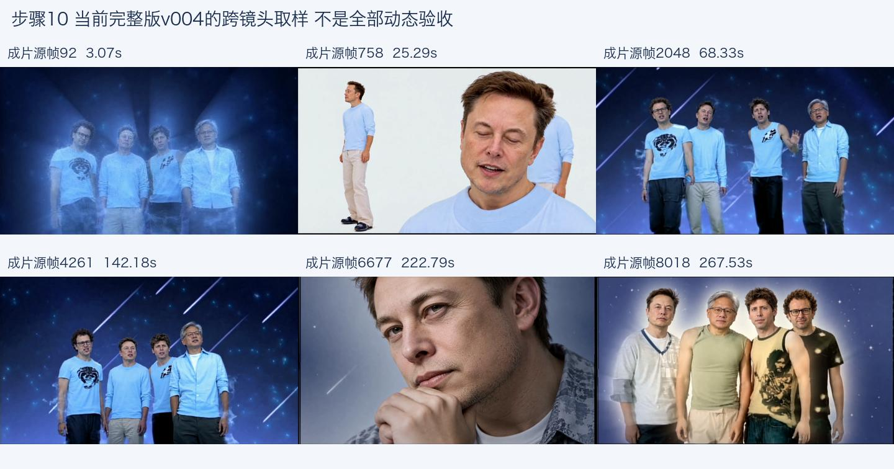

这些样本来自同一个完整v004文件，不是把各自最好看的版本临时摆在一起。全片要检查衣服、发色、身份和镜头节奏是否跨段稳定。全片8163帧的技术通过，不替代272秒的实际动态视觉验收。

来源：06_成片/完整版审看候选_v004/F4_完整版_内部待审_v004.mp4。

## 图23 步骤11配图 生成内容与最终包装要分清

这是根目录横屏片头与黄小木水印v2的实际取样。包装版本号与镜头生成版本号不同；不能因为水印片已经导出，就把仍有缺陷的生成镜头认定为最终验收。包装版时间从该文件自身0秒开始，不直接当作源片帧号。

来源：工程根目录 F4_流星雨_完整版_横屏片头_黄小木水印_v2.mp4。

## 图24 步骤12配图 文件应该去哪找

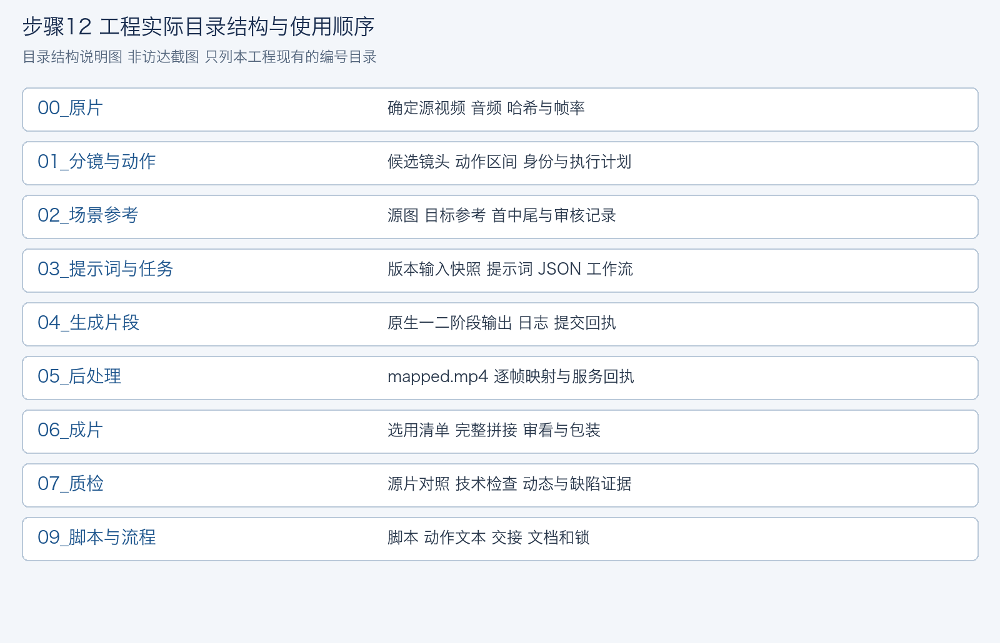

按00到07追踪素材到成片；09存脚本、交接与本文档。想复盘某一帧，从06合成清单找镜头版本，再回05、04、03、02和01查证据。没有08是当前编号留空，不能自行编造一个“必须存在”的处理环节。

来源：依据当前工程顶层目录整理；为说明图，不是文件管理器界面截图。

