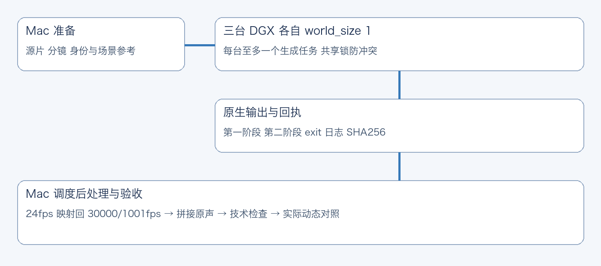
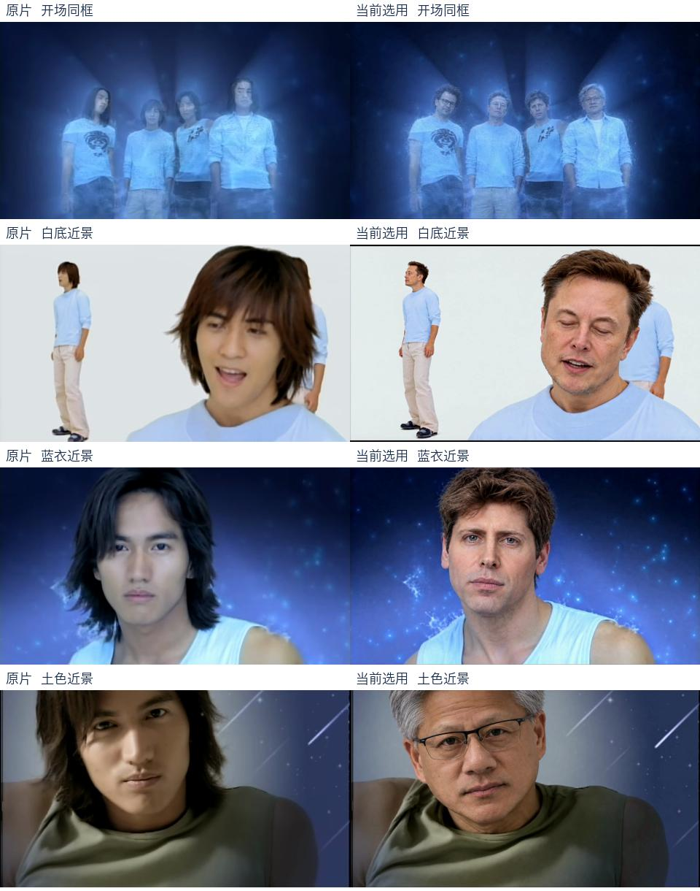

# AI 版《流星雨》背后的制作工作流｜Recast Video DGX（X 阅读版）

> 从 X 帖子来到这里？这是一份**面向第一次接触项目的读者**的快速导览：先看效果与思路，再领取物料、安装 Codex Skill，最后按需研究 ComfyUI 和 DGX Spark 多机流程。

**相关入口**：[黄小木的 X 帖子](https://x.com/ai_xiaomu/status/2112500851881525445) · [完整技术 README](README.md) · [原始项目 JayceHuang/recast-video-dgx](https://github.com/JayceHuang/recast-video-dgx) · [本 Fork](https://github.com/AsleepForNow/recast-video-dgx)

## 先说结论：开源的是一套可复用的制作方法

原帖提到“物料包，skill 均开源”。本仓库提供的不是一个点击按钮就能在线出片的网站，而是一个供 **OpenAI Codex** 使用的 **视频人物替换制作 Skill**：把原片分析、角色参考、逐镜任务、MiniMax H3 / ComfyUI 生成、多台 DGX Spark 协作、原声合成与人工质检串成可追踪的流程。



你可以把它当成一套“AI 视频制作 SOP + 脚本工具箱”：

- **想先学习**：直接看案例、24 组图解和命令示例；不需要购买 DGX Spark。
- **想让 Codex 帮你准备工程**：安装 Skill，让 Codex 先分析原片、检查镜头、组织参考和任务；这一步不等于启动 GPU 生成。
- **想实际生成视频**：仍然需要你自己准备有权使用的素材、MiniMax H3 / ComfyUI 的兼容运行环境、模型权重和算力，并按工程审核与授权步骤执行。

## 🎬 案例：四位 AI 人物演绎《流星雨》

历史案例把《流星雨》原 MV 中的四个角色映射为：

| 原角色 / 演员 | 目标人物 |
| --- | --- |
| 道明寺 / 言承旭 | 黄仁勋（Jensen Huang） |
| 花泽类 / 周渝民 | 马斯克（Elon Musk） |
| 西门 / 朱孝天 | 奥特曼（Sam Altman） |
| 美作 / 吴建豪 | 达里奥（Dario Amodei） |



这个案例涉及约 **272 秒、8163 帧**的源片；最终内部待审版本的选片表包含 **54 个分段**。这两个数字是历史案例的工程记录，**不是**本 Fork 重新实测的生成成果，更不代表每个镜头已通过最终视觉验收。

想看制作中的真实问题与修复过程：

- [F4 案例复盘](examples/f4-case-study.md)：角色对应、镜头分段、接段、失败修复和停止边界。
- [24 组制作配图](examples/gallery.md)：原片、参考图、H3 图、前后对比与质检示例。
- [验证记录](VALIDATION.md)：哪些测试确实做过、哪些 GPU 场景尚未在本次打包中复测。

## 📦 物料包与源码去哪里拿？

| 资源 | 入口 | 说明 |
| --- | --- | --- |
| Codex Skill 源码 | [当前 Fork](https://github.com/AsleepForNow/recast-video-dgx) | 安装入口是仓库根目录的 `SKILL.md` |
| 完整物料包 | [夸克网盘](https://pan.quark.cn/s/aff1c565d543) | 原仓库维护者提供的 F4《流星雨》资料包入口 |
| 资料包口令 | `/~09ec3bagb6~:/` | 链接失效或访问方式变化时，以维护者最新说明为准 |
| 图文教程 | [本地画廊](examples/gallery.md) | 24 组带说明的配图，无需网盘也可读 |
| 完整使用手册 | [README.md](README.md) | 详细命令、目录和工作流边界 |

**重要区别**：网盘资料包与 GitHub 源码是分别维护的；仓库里**不包含**完整原 MV、完整最终成片、人物原始角色卡、模型权重及私人集群配置。公开资料与版权说明见 [MEDIA_NOTICE.md](MEDIA_NOTICE.md)。

## 🚀 5 分钟看懂如何开始

### 1. 安装到 Codex

本仓库已有符合 Codex Skill 入口格式的 `SKILL.md`。在终端执行（目标目录不存在时）：

```bash
mkdir -p ~/.codex/skills
git clone https://github.com/AsleepForNow/recast-video-dgx.git ~/.codex/skills/recast-video-dgx
```

如果这个目录已经存在，**先检查本地修改并备份**，不要直接覆盖。安装目录不同于运行中的工程目录；克隆 Skill 不会自动安装模型，也不会启动视频生成。

### 2. 在 Codex 里这样说

> 使用 $recast-video-dgx。先分析我提供的视频和目标人物参考，列出角色映射、分镜、动作难点、需要我确认的参考图，以及当前机器还缺哪些依赖。只做分析和准备，不执行 GPU 生成。

如果已有项目需要续做：

> 使用 $recast-video-dgx，先读取现有工程的交接、停止记录和任务回执，确认已经完成什么、还有什么风险。不要重复提交任务；先汇报给我。

**建议第一次只跑规划阶段**，确认画面控制能力与素材权限后再决定是否生产。尤其不要把“整理成片 / 写教程”理解为允许重启之前停止的生成任务。

### 3. 本地做原片检查（不需要 GPU）

基本依赖为 **Python 3.10+、FFmpeg、ffprobe**。在 Skill 根目录内执行：

```bash
# 探测源片参数，确认帧率、时长、音轨
python3 scripts/recast.py probe /path/to/source.mp4

# 建立独立工程目录；source.mp4 替换为你有权使用的原片
python3 scripts/recast.py init /path/to/new-project --source /path/to/source.mp4 --id my-recast

# 抽取指定帧用于人工审核；不能代替连续播放动作
python3 scripts/recast.py frames /path/to/source.mp4 /path/to/frame-review --frames 0 60 119
```

后续可以按 [README.md 的完整命令](README.md#快速使用先跑本地检查) 制作 RGB 参考、冻结输入、预演资源分配与执行技术质检。每个镜头应先通过审核，不能因为脚本返回成功就自动视作画面正确。

## 🧠 这套工作流真正有用的地方

### A. 不先按固定秒数切片，而是先理解镜头

多人同框、转身、遮挡、复杂手势和嘴形都可能使角色身份漂移。流程要求先看原片的完整动作，再核对切点，按从 0 开始的 `[start,end)` 源帧区间记录，避免遗漏或重复帧。


### B. 把“是谁”和“这一镜在干什么”分开

身份卡回答“换成谁”，逐镜场景参考回答“穿什么、站哪里、做什么”。身份、服装、遮挡和动作不能只靠一张漂亮的静态照片来保证。


### C. 根据任务选择单机、双机合算或多机分段

| 模式 | 工作方式 | 适用前提 |
| --- | --- | --- |
| 单机 / 独立分段 | 每台机器处理不同镜头，`world_size=1` | 有已审核的独立任务 |
| 双机合算同一段 | 两台分别承担 `rank0` / `rank1`，`world_size=2` | 两端模型、网络和原生后端已验证 |
| 三机组合 | 两机合算 + 第三台独立，或三台各做一段 | 各台 GPU 无冲突，有真实待处理任务 |

这里的“双机”不等于默认快两倍：旧双机仓库的基准不能直接套用到完整 MV。多机真正执行前要核对 SSH、GPU 共享锁、授权、已有提交回执和停止状态。相关说明见 [DGX 调度文档](references/dgx.md) 和 [旧双机方案](vendor/dual-spark/README.md)。

### D. 保留原片时间线与原声，并用动态播放验收

生成结果需要映射回源片帧率、准确裁切与合成。这里的映射**不是光流插帧，也不是硬锁动作**；原声从原片单独复用。嘴形、视线、身份跳变与拼接边界仍需实际连续播放对照。


## 🔍 哪些东西不是“开箱即用”？

- **不是在线 SaaS**：仓库没有提供托管生成服务，安装 Skill 不等于具备 H3 推理环境。
- **不是全部模型与 ComfyUI 依赖打包**：基础 `assets/h3-api-base.json` 是 API 图模板，不保证直接拖入任意 ComfyUI 前端就能运行；请先阅读 [环境准入](references/comfyui.md)。
- **不是新硬件性能承诺**：打包验证包含 CPU / 合成视频与假后端测试，真实 DGX 多机推理仍需在自己的环境做短片冒烟验证。
- **不是 100% 自动审核**：生成器、QA 脚本和静态截图无法替代对人物身份、嘴形、动作与接段的逐镜动态检查。
- **不是一份可直接商用的影视素材授权**：第三方视频、音乐、照片、肖像、商标等权利必须另行确认。

## 🛠️ 想继续深挖？按这个顺序读

1. [完整 README](README.md)：安装、命令与项目结构。
2. [SKILL.md](SKILL.md)：Codex 实际执行时遵循的决策约束。
3. [生产流程](references/production.md)：镜头、参考图与制作工程。
4. [H3 / ComfyUI](references/comfyui.md)：模型输入、两阶段图与依赖。
5. [多机调度与停止](references/dgx.md)：分配、锁、回收和错误恢复。
6. [验证与限制](VALIDATION.md)：实际测试范围与未覆盖风险。

---

## 开源、来源与使用边界

这份 `readmeX.md` 是 **AsleepForNow Fork 的独立导览文档**，为从 [黄小木的 X 帖子](https://x.com/ai_xiaomu/status/2112500851881525445) 找来物料与 Skill 的读者重新组织内容；**不表示 Fork 作者是原始视频、工作流或案例的创作者**。

- **原项目与作者**：[JayceHuang/recast-video-dgx](https://github.com/JayceHuang/recast-video-dgx)，原仓库的版权署名和许可证保持不变。
- **历史双机实现**：[GaryLauLGY/MinimaxH3-Dual-Dgx-Spark](https://github.com/GaryLauLGY/MinimaxH3-Dual-Dgx-Spark)，当前仓库 `vendor/` 保存其固定版本与原许可证。
- **原创代码及文档**：按仓库 [MIT License](LICENSE) 的适用范围使用；商用代码与商用第三方素材是两回事，具体参阅 [MEDIA_NOTICE.md](MEDIA_NOTICE.md)。
- **涉及真实人物时**：确认肖像、表演与音频素材的授权，发布时注明 AI 人物替换，避免让观众误以为人物真实参与过相应表演。

如果你只是想先看看 **AI 怎么把一条长视频拆成可管理、可返修的镜头任务**，建议从 [F4 案例复盘](examples/f4-case-study.md) 和 [24 组画廊](examples/gallery.md) 开始；如果你准备动手复现，先用 Codex 做本地分析，再根据环境决定是否进入生成阶段。
