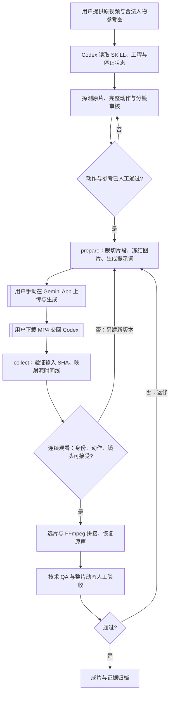

# Gemini App 无 API Key 人工交接模式

本页是 Fork 的补充工作流。Gemini App 是**人工视频生成/编辑环节**，Codex 只负责本地准备、回收、时间映射、拼接和质检。**没有自动调用 Gemini、没有绕过配额、没有保存 Gemini 登录凭证**。原 MiniMax H3/DGX Spark 路线仍在 `references/comfyui.md` 和 `references/dgx.md`。

## 适用条件与限制

- 用户有可使用视频生成功能的 Gemini App 账号；**个人账号需有符合条件的 Google AI 方案**，地区、年龄和平台可能限制功能。免费账号不保证有视频生成功能。
- Gemini 官方 App 的 Omni 视频编辑支持上传**1 段视频 + 最多 5 张图片**。部分地区不开放“上传视频进行编辑”。详情：[Google iPhone/iPad 官方帮助](https://support.google.com/gemini/answer/16126339?co=GENIE.Platform%3DiOS&hl=en)。
- 这条路径建议**单片段不超过 10 秒**，不保证原片时长、帧数、动作、嘴形或场景完全一致；若 Gemini 输出短于目标时间线，脚本拒绝静默补帧。尤其不要把视频的**内容相似**和**逐帧一致**混为一谈。
- 生成权利要求与平台内容政策依然适用；只使用有权使用的视频、肖像、声音、音乐。禁止以此流程误导别人认为人物真实参与了表演。
- 参考图片最多 5 张；多人同框身份保持不确定时优先拆镜、人工确认或换用更合适的模型。**不能简单宣称 Gemini 可直接复刻 H3 的全部能力。**

## Codex 实际步骤

1. 读取工程 `project.json`，检查是否存在停止指令，确定只是规划还是已授权生成。原视频与人物参考由用户提供。
2. `python3 scripts/recast.py probe source.mp4` 验证原片元数据。人工连续播放，建立镜头和人物追踪；`validate-plan` 确保帧段不重叠、不缺漏。
3. 为每段建立一个如 [gemini-task.example.json](../examples/gemini-task.example.json) 的任务 JSON，填写**实际看过**的动作、身份、画面控制目标。两份审核记录必须真实填写 `passed/reviewer/at/evidence`，不能伪造。
4. 运行 `prepare` 冻结**源片裁切、五张以内参考图和提示词**，并输出 SHA256。每次更改使用新版本、新目录。
5. **用户手动**在 Gemini App 中选择视频创作入口，上传 `inputs/segment_for_gemini.mp4` 和参考图片，粘贴 `prompt.txt`。如果用户没有视频编辑入口，流程停在这一关，不使用隐蔽模拟登录、未授权 API 或自动绕过权限。
6. 用户手动下载生成的 MP4 并交给 Codex。运行 `collect` 验证原任务文件没变、输出的真实 FPS 和时长是否覆盖目标区间，再按源帧时间线映射。该映射只是取帧，不证明原动作等同。
7. 各段人工连续审查，记录失败与修复；只有通过审查才能作为正式选片。构建与实际下载结果一致的 `plan.json`，用原有 `assemble --preview` 和 `qa --audio-source` 合成并进行技术审核。最终版本需要各段审核记录和整片实际观看。
8. 既有 F4 `examples/f4-case-study.md` **只是 MiniMax H3 历史案例**，绝不能把图示或基准宣称为 Gemini 实测。

## 命令示例

在仓库根目录运行，依赖 Python 3.10+ 和 FFmpeg/ffprobe；下面路径需要替换为真实路径。

```bash
python3 scripts/recast.py probe /path/to/source.mp4
cp examples/gemini-task.example.json /path/to/S001-v001.json
# 编辑任务，填真实分镜区间、路径与审核记录

python3 scripts/gemini_app.py prepare /path/to/S001-v001.json /path/to/handoff/S001-v001
# 这里暂停，手动在 Gemini App 上传 handoff 中的 mp4 + 图 + prompt.txt 并下载结果
python3 scripts/gemini_app.py collect /path/to/handoff/S001-v001 /path/to/gemini-downloaded.mp4 /path/to/mapped/S001-v001.mp4

# 根据工程 plan.json 中各段 selected_file 和审核结果合成
python3 scripts/recast.py assemble /path/to/plan.json /path/to/source.mp4 /path/to/preview.mp4 --preview
python3 scripts/recast.py qa /path/to/preview.mp4 /path/to/qa.json --frames 120 --fps 30000/1001 --audio-source /path/to/source.mp4
```

注意：示例里 `qa --frames 120` 仅对应假设的 **120 帧完整源片**；实际工程必须填写原片的完整帧数与 FPS。生成视频可能因模型输出与源片差异而无法通过视觉验收，技术 QA 通过也不是最终通过。

## 交接流程图



## 与原版 H3 的区别

| 项目 | Gemini App 人工模式 | 原 H3/DGX 路线 |
| --- | --- | --- |
| 生成引擎 | Gemini Omni（具体受 App 账号/地区影响） | MiniMax H3 / ComfyUI |
| 视频调用 | 用户手动在 App 上传与下载 | 原生 H3 任务、SSH GPU 调度 |
| API Key | 不需要 | 原生部署而非 Gemini API |
| 控制精度 | 提示词/参考图为软约束，不保证逐帧 | 参考 / Guide 仍是软约束，不保证硬锁 |
| 输出整理 | Codex 本地映射、拼接和验收 | Codex 本地映射、拼接和验收 |
| 可自动运行整片 | 否，需要人工交接 | 需真实硬件和用户明确授权 |

官方入口：[Gemini App 视频制作说明](https://support.google.com/gemini/answer/16126339?co=GENIE.Platform%3DiOS&hl=en)、[Gemini Omni 模型能力/限制](https://ai.google.dev/gemini-api/docs/omni)（API 文档只作模型能力参考，**本模式不调用 API**）。
